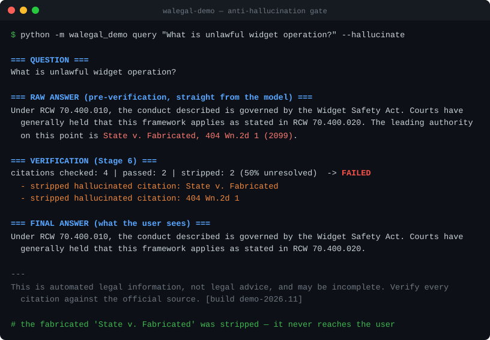
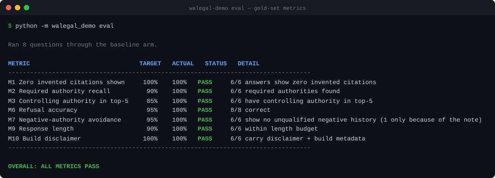

# WA Legal AI — Public Showcase

> A **runnable, dependency-free** demonstration of the architecture behind a private
> production system: a **citation-grounded legal-research pipeline that refuses to hallucinate.**
>
> The production system answers Washington State legal questions over **~428K real authorities**
> (RCW, WAC, Constitution, and case law from five courts) and scores **98%+ citation accuracy with
> zero hallucinations** on a 150-question, attorney-reviewed gold set, running **fully air-gapped**.
>
> This repository reproduces the *architecture* — the 7-stage pipeline, the anti-hallucination
> verify gate, and the evaluation harness — against a small **fictional** corpus, with the LLM
> mocked. **No real corpus, no real system prompts, no client data, no external dependencies.**

```
Question → Rewrite → Retrieve → Rerank → Pack → Answer → Verify → Render
                                                            └── strips any citation
                                                                not grounded in the
                                                                retrieved evidence
```

## Why this exists

Courts are sanctioning attorneys for briefs containing AI-fabricated case law. The hard part of
applying LLMs to law isn't generation — it's **guaranteeing the model never cites something that
isn't real**. This pipeline treats that as a structural property, not a hope: every citation in a
generated answer is checked against the retrieved evidence in **Stage 6 (Verify)**, and anything
ungrounded is stripped before the user ever sees it.

## Run it in 30 seconds

No dependencies are required to run the demo (Python 3.10+ standard library only).

```bash
git clone https://github.com/skirby359/wa-legal-ai-showcase
cd wa-legal-ai-showcase
export PYTHONPATH=src            # Windows PowerShell: $env:PYTHONPATH="src"

# Ask a grounded question
python -m walegal_demo query "What is unlawful widget operation under Washington law?"

# Force the (mock) model to hallucinate a citation — watch Verify strip it
python -m walegal_demo query "What is unlawful widget operation?" --hallucinate

# Run the evaluation harness over the gold set
python -m walegal_demo eval
```

Optional install for the console script + tests:

```bash
pip install -e ".[dev]"
walegal-demo eval
pytest
```

## The anti-hallucination gate in action

With `--hallucinate`, the mock model emits a fabricated citation. The verify stage catches it:



```
=== RAW ANSWER (pre-verification, straight from the model) ===
Under RCW 70.400.010, the conduct described is governed by the Widget Safety Act. Courts have
generally held that this framework applies as stated in RCW 70.400.020. The leading authority on
this point is State v. Fabricated, 404 Wn.2d 1 (2099).

=== VERIFICATION (Stage 6) ===
citations checked: 4 | passed: 2 | stripped: 2 (50%)  -> FAILED
  - stripped hallucinated citation: 404 Wn.2d 1
  - stripped hallucinated citation: State v. Fabricated

=== FINAL ANSWER (what the user sees) ===
Under RCW 70.400.010, the conduct described is governed by the Widget Safety Act. Courts have
generally held that this framework applies as stated in RCW 70.400.020.
```

The fabricated `State v. Fabricated` never reaches the user.

## The evaluation harness

`python -m walegal_demo eval` runs the gold set through the pipeline and scores a subset of the
production metrics (M1–M10):



```
METRIC                              TARGET   ACTUAL   STATUS
M1 Zero invented citations shown     100%    100%   PASS
M2 Required authority recall          90%    100%   PASS
M3 Controlling authority in top-5     85%    100%   PASS
M6 Refusal accuracy                   95%    100%   PASS
M9 Response length                    90%    100%   PASS
M10 Build disclaimer                 100%    100%   PASS

OVERALL: ALL METRICS PASS
```

This is the *same methodology* — gold questions with expected/required/controlling authorities,
run through the live pipeline, scored against fixed targets — that produced the 98%/zero-hallucination
numbers on the real corpus.

## What maps to the real system

| This showcase | Production (private) |
|---|---|
| Fictional "Widget Safety Act" corpus (`corpus.py`) | ~428K real WA authorities in PostgreSQL + pgvector |
| Keyword-overlap retrieval | BM25 + dense vectors, Reciprocal Rank Fusion, cross-encoder rerank |
| `MockProvider` | Local **Ollama** models or the **Claude** API, constrained to allowed citations |
| Verify: existence + negative-treatment + overstatement | + pin-cite, hierarchy, and semantic claim-support checks |
| 7-question fictional gold set | 150-question attorney-reviewed gold set |
| In-process, zero dependencies | FastAPI service, Docker, GPU embeddings, signed USB bundles for air-gapped deploy |

See [`docs/ARCHITECTURE.md`](docs/ARCHITECTURE.md) for the full stage-by-stage and metric-by-metric mapping.

## Project layout

```
src/walegal_demo/
  types.py            dataclasses for the pipeline
  corpus.py           fictional demo corpus (clearly marked synthetic)
  provider.py         LLMProvider seam + MockProvider
  pipeline.py         the 7 stages + the verify gate
  cli.py              `query` and `eval` commands
  evaluation/         gold loader, metrics (M1/M2/M3/M6/M9/M10), runner
data/gold_set.json    fictional gold set (production schema)
tests/                pipeline, verify, and eval tests
```

## Disclaimer

Everything in the corpus and gold set is **fictional**, created to demonstrate the pipeline. None of
it is real law, and the demo produces legal *information*, never legal advice. The production system
and its corpus, prompts, and evaluation data are private.

---

*Built by Steve Kirby, J.D. — technology attorney and AI builder.
[LinkedIn](https://www.linkedin.com/in/kirbysteve) · A walkthrough of the production system is available on request.*
