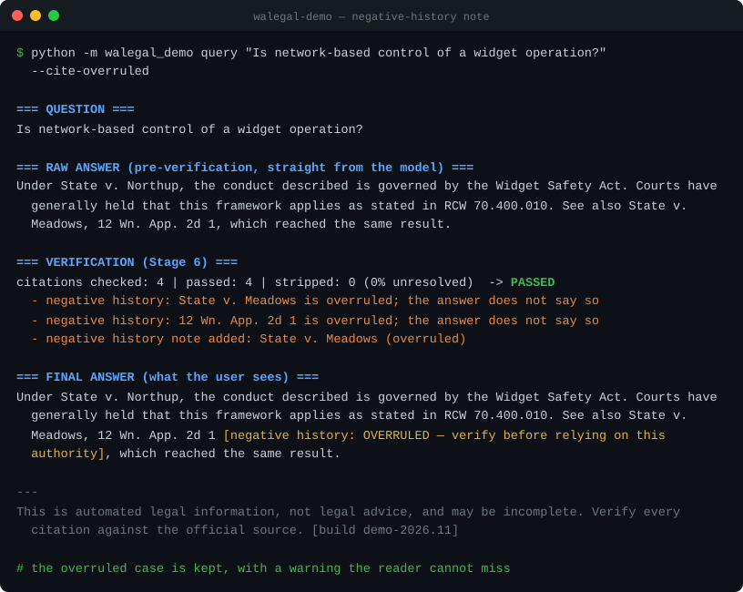
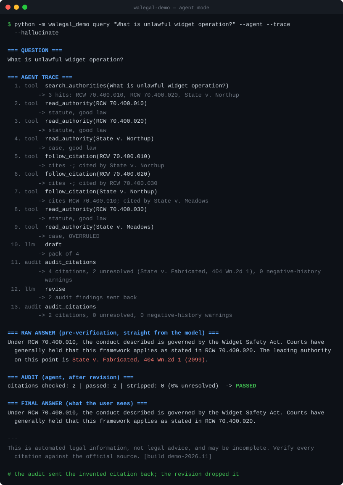

# WA Legal AI — Public Showcase

> A **runnable, dependency-free** demonstration of the architecture behind a private
> production system: a **citation-grounded legal-research pipeline that refuses to hallucinate.**
>
> The production system answers Washington State legal questions over **~271K real authorities**
> (RCW, WAC, court rules, the Constitution, and case law from five courts) and scores **98%+
> citation accuracy with zero hallucinations** on a 150-question, attorney-reviewed gold set,
> running **fully air-gapped**.
>
> This repository reproduces the *architecture* — the 7-stage pipeline, the anti-hallucination
> verify gate, the negative-history note, an agentic research mode measured against the
> pipeline, and the evaluation harness — against a small **fictional** corpus, with the LLM
> mocked. **No real corpus, no real system prompts, no client data, no external dependencies.**

```
Question → Rewrite → Retrieve → Rerank → Pack → Answer → Verify → Render
                                                            ├── strips any citation not
                                                            │   grounded in the retrieved evidence
                                                            └── flags overruled / repealed
                                                                authority the answer treats as good law
```

## Why this exists

Courts are sanctioning attorneys for briefs containing AI-fabricated case law. The hard part of
applying LLMs to law isn't generation — it's **guaranteeing the model never cites something that
isn't real**, and never presents dead law as good law. This pipeline treats both as structural
properties, not hopes: every citation in a generated answer is checked against the retrieved
evidence in **Stage 6 (Verify)**. Anything ungrounded is stripped before the user ever sees it.
Anything overruled or repealed carries a warning.

## Run it in 30 seconds

No dependencies are required to run the demo (Python 3.10+ standard library only).

```bash
git clone https://github.com/skirby359/wa-legal-ai-showcase
cd wa-legal-ai-showcase
export PYTHONPATH=src            # Windows PowerShell: $env:PYTHONPATH="src"

# Ask a grounded question
python -m walegal_demo query "What is unlawful widget operation under Washington law?"

# Force the (mock) model to hallucinate a citation — watch Verify strip it
python -m walegal_demo query "What is unlawful widget operation?" --hallucinate

# Make it cite an overruled case as good law — watch the negative-history note
python -m walegal_demo query "Is network-based control of a widget operation?" --cite-overruled

# Answer in agent mode and show every tool call
python -m walegal_demo query "What is unlawful widget operation?" --agent --trace --hallucinate

# Run the evaluation harness over the gold set, then A/B the two modes
python -m walegal_demo eval
python -m walegal_demo compare
```

Optional install for the console script + tests:

```bash
pip install -e ".[dev]"
walegal-demo eval
pytest
```

## The anti-hallucination gate in action

With `--hallucinate`, the mock model emits a fabricated citation. The verify stage catches it:


```
=== RAW ANSWER (pre-verification, straight from the model) ===
Under RCW 70.400.010, the conduct described is governed by the Widget Safety Act. Courts have
generally held that this framework applies as stated in RCW 70.400.020. The leading authority on
this point is State v. Fabricated, 404 Wn.2d 1 (2099).

=== VERIFICATION (Stage 6) ===
citations checked: 4 | passed: 2 | stripped: 2 (50% unresolved)  -> FAILED
  - stripped hallucinated citation: State v. Fabricated
  - stripped hallucinated citation: 404 Wn.2d 1

=== FINAL ANSWER (what the user sees) ===
Under RCW 70.400.010, the conduct described is governed by the Widget Safety Act. Courts have
generally held that this framework applies as stated in RCW 70.400.020.
```

The fabricated `State v. Fabricated` never reaches the user.

## Negative history: annotate, don't delete

A real citation can still be wrong to rely on: the case was overruled, the statute repealed. The
evidence block labels such authorities, and the answer prompt says to say so, but a model can
still cite one as good law. In one production dev-split run, a local model did that in 6 of 91
answers, even though the evidence it was given labelled each case `OVERRULED`, `ABROGATED` or
`SUPERSEDED`.

Stripping those citations would be the wrong fix. The status comes from a machine-derived
citation graph, and a case "overruled on other grounds" is still good law for other points. So
the verify stage keeps the citation and inserts a note right after it, in every sentence that
cites it without saying so:



The note uses production's wording. The status check is then re-run on the final text.
The metric (M7) passes, and the report still counts how many answers passed **only because
of the note**, so the model's own misses stay visible instead of being papered over.

## Agent mode: does agency help?

The pipeline makes one retrieval pass. Agent mode lets a model decide what to search, which
authorities to read and which citations to follow, then audits its draft before anything is
returned:

```
plan ──► tools ──► plan …               tools: search_authorities  read_authority
  └──► draft ──► audit ──► finalize            follow_citation     audit_citations (= Verify)
                   └──► revise ──► audit
```

In production this is a **LangGraph** loop talking to a local **MCP** server over stdio, and it
works with any chat model (local Ollama, Claude, OpenAI). Here it is the same shape in the
standard library: the four tools are plain functions over the corpus, the citation graph is
built from the citations inside each authority's text, and a scripted planner stands in for the
model's tool choices.



**Built for a fair A/B.** Only two things differ from the pipeline: how evidence is gathered,
and the audit-and-revise loop. The refusal rules, the answer model, the pack size and hierarchy
ordering, the verifier, the negative-history note, the renderer and the scoring code are all
shared. The audit gate is stricter than the pipeline by design. If an invented citation survives
the one revision, the user gets "could not verify" with the failed citations named, where the
pipeline would strip the citation and answer anyway. `compare` makes that trade-off visible:

```
$ python -m walegal_demo compare --hallucinate --stubborn

A/B on 8 gold questions: same corpus, same mock model, same verifier, same scoring.

                                                    BASELINE        AGENT
---------------------------------------------------------------------------
M1 Zero invented citations shown                        100%          n/a
M2 Required authority recall                            100%          n/a
M3 Controlling authority in top-5                       100%          n/a
M6 Refusal accuracy                                     100%     25% FAIL
M7 Negative-authority avoidance                         100%          n/a
M9 Response length                                      100%          n/a
M10 Build disclaimer                                    100%          n/a
outcomes: answered / could-not-verify / refused    6 / 0 / 2    0 / 6 / 2
answers citing nothing                                     0            0
answers with a negative-history note added                 1            0
tool calls per question                                  0.0          9.3
model calls per question                                 1.0          2.0
---------------------------------------------------------------------------
```

A metric with nothing to score reads `n/a`, not a vacuous 100%.

**The production result.** On the 104-question dev split, with both arms on the same local 9B
model and the same judge, **agency did not pay for itself**:

- required-authority recall fell from 87% to 73%;
- 18 answers came back "could not verify";
- median latency was 2.4× the pipeline's.

The small model narrowed its own searches and rarely followed citations. The most valuable thing
the experiment found was about the *baseline*. It wrote prose citing **no authority at all** in
41% of answers, which a citation verifier passes vacuously. It was also running with the
model's default context window, so its evidence was being truncated. Fixing the context window
cut uncited answers from 41% to 24%. That surfaced the negative-history misses above, and the
note now runs in both modes. The agent has not yet been re-run against the fixed baseline. A
stronger planner model is the obvious next arm.

## The evaluation harness

`python -m walegal_demo eval` runs the gold set through the pipeline (or `--arm agent`) and
scores a subset of the production metrics (M1–M10):


```
METRIC                              TARGET   ACTUAL   STATUS
M1 Zero invented citations shown     100%    100%   PASS
M2 Required authority recall          90%    100%   PASS
M3 Controlling authority in top-5     85%    100%   PASS
M6 Refusal accuracy                   95%    100%   PASS
M7 Negative-authority avoidance       95%    100%   PASS   (1 only because of the note)
M9 Response length                    90%    100%   PASS
M10 Build disclaimer                 100%    100%   PASS

OVERALL: ALL METRICS PASS
```

M1 is **measured** on the text the user sees. The harness re-extracts every citation from the
final answer and resolves it against the evidence, so the metric can fail. It does not assume
the strip step worked.

This is the *same methodology* — gold questions with expected/required/controlling authorities,
run through the live pipeline, scored against fixed targets — that produced the 98%/zero-hallucination
numbers on the real corpus.

## Tests that can't spend money

`tests/conftest.py` blocks every network connection for the whole suite, and a test proves the
guard really blocks. Production has the same kind of guard aimed at paid LLM APIs. It was added
after a test run was found calling a hosted model: an API key in the environment let the code
auto-select it, and removing the key didn't help because the app reloaded it from its own config.
A guard in the test harness doesn't depend on the environment.

## What maps to the real system

| This showcase | Production (private) |
|---|---|
| Fictional "Widget Safety Act" corpus (`corpus.py`) | ~271K real WA authorities in PostgreSQL + pgvector |
| Keyword-overlap retrieval | BM25 + dense vectors, Reciprocal Rank Fusion, cross-encoder rerank |
| `MockProvider` | Local **Ollama** models or the **Claude** API, constrained to allowed citations |
| Verify: existence + negative history + overstatement | + pin-cite and hierarchy checks; claim support graded by an LLM judge in evaluation |
| Negative-history note (`annotate_negative_history`) | Same function and wording, in the pipeline and in agent mode |
| `agent.py`: stdlib loop, scripted planner, four tool functions | LangGraph loop + MCP stdio server, any chat model, hard caps and a JSONL trace |
| `compare`: both arms through one scoring function | `answerer=` hook on the harness; same judge, pack limits and verifier for both arms |
| 8-question fictional gold set | 150-question attorney-reviewed gold set |
| Network blocked in tests | Paid LLM APIs blocked in tests |
| In-process, zero dependencies | FastAPI service, Docker, GPU embeddings, signed USB bundles for air-gapped deploy |

See [`docs/ARCHITECTURE.md`](docs/ARCHITECTURE.md) for the full stage-by-stage and metric-by-metric mapping.

## Proven across domains

The architecture isn't bespoke to Washington law. The same 7-stage pipeline and verify gate were
re-pointed at an entirely different body of authority — **federal tax-exempt municipal bond law**
(the Internal Revenue Code, Treasury Regulations, IRS Revenue Procedures / Rulings / Notices, and
Tax Court / Federal Circuit opinions) — as a separate private production system.

Re-targeting meant rewriting the **citation grammar** (IRC §, Treas. Reg., Rev. Proc./Rul., Notice),
the **authority hierarchy** (IRC › Treasury Regs › SCOTUS › Federal Circuit › Tax Court › IRS
guidance), and the **answer prompt** — *not* rebuilding the engine. The pipeline, the Verify gate,
and the evaluation harness transferred unchanged.

On a **12-question, attorney-authored tax gold set** — statutory interpretation, multi-source
synthesis, superseded-guidance history, pin-cite precision, case-law application, and out-of-domain
refusal — the system passed **all 10 metric gates**. The headline eight:

| Metric | Target | Result |
|---|---|---|
| Invented citations shown to user | 0 | **0** |
| Required-authority recall | ≥90% | **100%** (16/16) |
| Claim-to-evidence coverage | ≥95% | **98.9%** (137/139 grounded; 2 stripped by Verify) |
| Controlling authority in top-5 | ≥85% | **90.9%** |
| Refusal accuracy (out-of-domain) | ≥95% | **100%** (12/12) |
| Negative-authority avoidance (superseded / overruled) | ≥95% | **100%** |
| Authority-hierarchy compliance | ≥90% | **100%** |
| Pin-cite accuracy | ≥90% | **100%** |

The tax domain stresses something Washington law rarely does: **superseded guidance** — e.g. Rev.
Proc. 2016-44 supersedes 97-13/97-14, then 2017-13 modifies it. The same Verify-stage machinery that
strips hallucinated citations also avoids citing dead authority, so the system surfaces the
*controlling* rule, not the repealed one.

*Like the WA system, the bond system runs on a real corpus — here, entirely public IRS / IRC /
Treasury material — with its prompts and tuning kept private. Figures above are from the 2026-04-26
evaluation run.*

## Project layout

```
src/walegal_demo/
  types.py            dataclasses for the pipeline and agent
  corpus.py           fictional demo corpus (clearly marked synthetic)
  provider.py         LLMProvider seam + MockProvider (with switches to misbehave)
  pipeline.py         the 7 stages, the verify gate, the negative-history note
  agent.py            agent mode: four tools, citation graph, audit-and-revise loop
  cli.py              `query`, `eval` and `compare` commands
  evaluation/         gold loader, metrics (M1/M2/M3/M6/M7/M9/M10), runner for either arm
data/gold_set.json    fictional gold set (production schema)
docs/build_svgs.py    renders the README images from real CLI output
tests/                pipeline, verify, agent, eval and network-guard tests
```

## Disclaimer

Everything in the corpus and gold set is **fictional**, created to demonstrate the pipeline. None of
it is real law, and the demo produces legal *information*, never legal advice. The production system
and its corpus, prompts, and evaluation data are private.

---

*Built by Steve Kirby, J.D. — technology attorney and AI builder.
[LinkedIn](https://www.linkedin.com/in/kirbysteve) · A walkthrough of the production system is available on request.*
